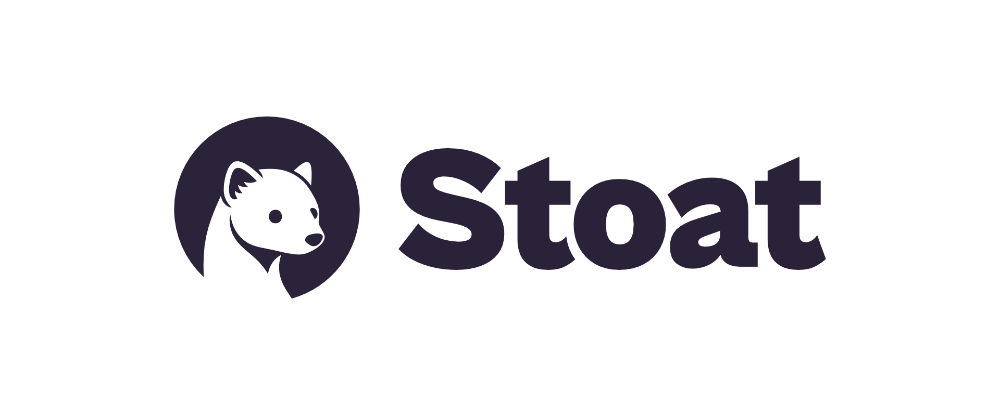
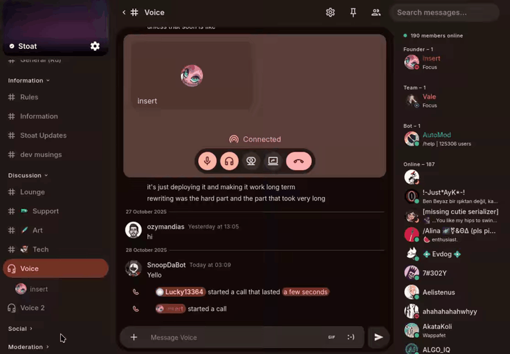
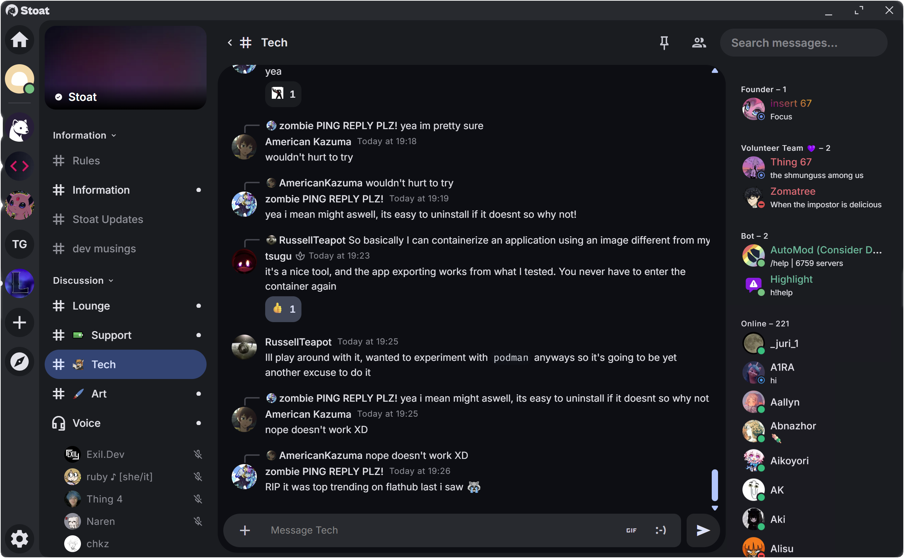

# Stoat Chat

Stoat Chat is the open chat app people look up as Stoat Discord. You get servers, text channels, voice, friends, and roles. The layout is the same class of tool as Discord. The name on the account is Stoat, not Discord.

The Stoat app is the browser client. A stoat self hosted chat is the same idea on a machine you control. If the question is can you self host stoat, the answer is yes for the software. The button below is the hosted app. The files in this tree are the companion client, the backend notes, and a second chat server of the same class. They are not a finished installer.

The brief lists no price. Do not pay a site that sells a "Stoat unlock". There is no paid seat described here.

## Minimum Supported Rust Version

The backend guide asks for Rust 1.86.0 or higher. That line is about the service crates. Those crates are not in this file set, so a Rust build will not start from this folder. The Stoat app you open in the browser does not need a Rust toolchain on your laptop.

`workflows/rust.yaml` is the workflow that checks that backend. `workflows/publish-crates.yml` publishes crates. `workflows/tag-release.yml` tags a release. Read them as the shape of the pipeline. Do not expect them to compile a server from the TypeScript in this tree.

## Environment Variables

The web client reads its target from [env.ts](env.ts). `STOAT_HOST` is `stoat.chat`. The default API string is `https://api.stoat.chat`. `normalizeHost` maps the older revolt.chat hosts and the current stoat.chat hosts back to `stoat.chat`. Any other host is left as you typed it.

`DEFAULT_HOST` comes from `VITE_DEV_HOST` in dev, then `VITE_HOST`, then `STOAT_HOST`. `DEFAULT_API_URL` comes from `VITE_DEV_API_URL` in dev, then `VITE_API_URL`, then the default API. If the API is not one of the official Stoat or older Revolt URLs and the host is still `stoat.chat`, the file logs that `VITE_HOST` is required. Set both, or set neither and stay on the hosted app.

Overrides in the same file: `VITE_DEV_WS_URL`, `VITE_DEV_MEDIA_URL`, `VITE_DEV_PROXY_URL`, `VITE_DEV_GIFBOX_URL`, and `VITE_RNNOISE_WORKLET_CDN_URL`. `VITE_SESSION_ID`, `VITE_TOKEN`, and `VITE_USER_ID` are dev-only. Do not commit a token. A token in a screenshot is a leaked session.

| Name | Role |
| --- | --- |
| VITE_API_URL | API base for the web client |
| VITE_HOST | Host label when the API is not the official one |
| VITE_DEV_WS_URL | Socket override while developing |
| VITE_DEV_MEDIA_URL | Media override while developing |
| VITE_DEV_GIFBOX_URL | Gif proxy override while developing |

The backend guide also names `RUST_LOG` (default `info`) and OpenTelemetry exporters for logs, traces, and metrics. `OTEL_TRACES_SAMPLER` defaults to `parentbased_always_on`. `OTEL_TRACES_SAMPLER_ARG` defaults to `1.0`. Those variables belong to the Rust services. They do nothing for the TypeScript client in this folder.

## Deployment Guide

Deploy the hosted Stoat Chat from the download button. Deploy a stoat self hosted chat only if you mean to run the services yourself. `compose.yml` is the stack file from the backend repo. `livekit.example.yml` is an example voice config. Neither file is a click-to-install build of the Stoat app.

The guide names these services: `delta` for the API, `bonfire` for events, `autumn` for files, `january` for the media proxy, and `gifbox` for gif search. MongoDB, Redis, MinIO, and RabbitMQ sit beside them. This folder does not include those crate sources.

### Cutting new crate releases

The upstream steps are `just patch`, `just minor`, `just major`, then a commit, then `just publish`. The task file that defines those names is not in this set. Do not run them here and expect crates to publish.

`workflows/release.yml` and `release-please-config.json` are release metadata. `.release-please-manifest.json` is the version manifest for the web repo. They bump library versions. They do not change who can join a server.

### Cutting new binary releases

The upstream binary step is `just release`, then a changelog on the project that owns the binaries. Again, the task runner is not here. `docker.yaml` is the backend image workflow. `workflows/docs.yml` builds docs. `build-and-test.yml` is the web check workflow. `vercel.json` is the web host config. None of these is the Stoat app store.

### Build the app

[package.json](package.json) is `stoat-for-web` at version `0.16.3`. It asks for Node 16 or newer and pnpm 6 or newer. It has no `scripts` block. `pnpm-workspace.yaml` lists the workspace. The client package that would run `test:unit` is not this file, and it is not copied here. Do not expect `npm test` or `pnpm build` to finish from this folder.

The upstream web guide uses `mise install:frozen`, `mise build:deps`, `mise build`, and `mise build:prod`, then ships `packages/client/dist`. That `dist` directory is not in this tree. `tsconfig.json` is the client TypeScript config. It does not emit a site by itself.

`renovate.json` is the dependency bot config. `settings.json` is an editor config. `bug.yml` is the issue form. They do not start a server.

### Routing Information

The web app asks for these paths: `/login`, `/pwa`, `/dev`, `/discover`, `/settings`, `/invite`, `/bot`, `/friends`, `/server`, and `/channel`. A host that only serves `/` will break invites and settings. Point every one of those paths at the client.

| Path | What it is for |
| --- | --- |
| /login | Sign in |
| /discover | Find a server |
| /invite | Open an invite |
| /friends | Friend list |
| /server | A server you joined |
| /channel | A channel inside a server |
| /settings | Your settings |
| /bot | Bot setup |
| /pwa | Installable browser shell |
| /dev | Dev tools route |

[ordering.ts](ordering.ts) exports `orderedCategories` and `applyChannelOrdering`. Categories and channels keep the order the server stored. [largeServer.ts](channels/largeServer.ts) exports `isLargeServer`. The threshold is `LARGE_SERVER_MEMBER_THRESHOLD` of 1000. Above that, the client should not pull every member.

[railDrag.ts](navigation/railDrag.ts) exports `createRailDrag` plus `RailEntry` and `RailIntent`. That is the server rail drag. [stoatWebTheme.ts](themes/stoatWebTheme.ts) exports `createStoatWebVariables`. [fonts.ts](themes/fonts.ts) exports `FONTS`, `MONOSPACE_FONTS`, `DEFAULT_FONT` (`Open Sans`), and `DEFAULT_MONO_FONT` (`Fira Code`).

## Testing

The backend test line is `TEST_DB=REFERENCE cargo nextest run` or `TEST_DB=MONGODB cargo nextest run`, after `docker compose up -d`. The crates those tests import are not in this folder. Compose can still describe the data services. It cannot run a test that lives in a crate you do not have.

`scripts/generate-shitload-of-users.py` is a debug script. It reads `API_URL`, `MAILHOG_API`, `COUNT`, and `INVITE`. If any one is missing, the assert stops it. It uses httpx, talks to a mail catcher, and is meant for a dev stand. The file itself says antispam would stop the same burst on a real network. Do not point it at the public Stoat Chat.

`fixtures/server_with_roles.json` is a sample server: users named Owner, Moderator, and User, plus a TextChannel named General. `fixtures/group_with_members.json` is the group sample. They are fixtures, not your account.

## License

`LICENSE` is the GNU Affero General Public License v3.0 text from the Stoat backend, with the note that individual crates may carry their own license. Those crate license files are not copied here. The web `package.json` does not name a license of its own.

The gateway and CDN files in this tree are from a second project, Spacebar, and their headers also name AGPL-3.0. One license file is all this folder stores. If you copy `gateway/Identify.ts` out, keep the AGPL notice that is already at the top of that file.

AGPL does not turn Stoat Chat into a support contract. It also does not forbid the hosted app. can you self host stoat is a deploy question, not a license loophole.

## About

Stoat Chat is a server-and-channel app. You join a server, open a channel, and talk. Voice is part of the product. Bots and custom emoji are part of the same family of tools. Stoat Discord is the search phrase for that comparison. The Stoat app is the client. A stoat self hosted chat is the stack on your own host.

The second codebase here is a Discord-compatible server: HTTP API, gateway, CDN, and a WebRTC entry the upstream tree describes. It is a close tool. It is not the Stoat installer, and a Stoat session does not log into it.

[Identify.ts](gateway/Identify.ts) exports `onIdentify`. [Heartbeat.ts](gateway/Heartbeat.ts) exports `onHeartbeat` and `QoSPayload`. [start.ts](gateway/start.ts) builds a `GatewayServer`. If `PORT` is not a number, the port becomes 3002. The process title is `sb-gw-` plus the worker id or that port. [Server.ts](gateway/Server.ts) is the class `GatewayServer`.

`gateway/Resume.ts`, `gateway/PresenceUpdate.ts`, and `gateway/VoiceStateUpdate.ts` are the other opcodes in this set. `gateway/Send.ts` and `gateway/WebSocket.ts` are the socket helpers. Imports such as `@spacebar/gateway` will not resolve in this flattened tree.

[avatars.ts](cdn/avatars.ts) posts and gets `/avatars` style routes and exports `getAvatar`. `cdn/emojis.ts` is the emoji route. `cdn/Storage.ts` is the storage helper. `cdn/Server.ts` is the class `CDNServer`. `start` runs monitoring, database init, config, and a JWT key manager. Those modules are not in this folder, so the class will not boot from here. `LOG_REQUESTS` turns request logs on when the variable is set.

`gifs/GifProviderManager.ts` is the class `GifProviderManager`. `connections/GitHub.ts` is one connection provider. `assets/features.json` lists flags such as `COMMUNITY`, `DISCOVERABLE`, `NEWS`, `BANNER`, and `VANITY_URL`. That list is the companion server's feature names. It is not a Stoat price table, and `COMMERCE` in that file is not a fee this page can quote.

## Documentation

[sidebars.ts](docs/sidebars.ts) is the docs sidebar. It has a Developers category whose copy says "Building with Stoat", then autogenerated developer docs. `docs/docusaurus.config.ts` is the docs site config. The markdown docs themselves are not in this tree. The sidebar will not render a site without them.

Use the vendor site for account help. Use this README for the files that were packed. A 404 on a docs path is a missing page, not a broken server.

## Contributing

Report a client bug with the route, the server size, and whether voice was on. Report a gateway bug with the opcode name: identify, heartbeat, resume, presence, or voice state. Do not send `VITE_TOKEN` or a session id.

`workflows/validate-pr-title.yml` checks pull request titles on the backend repo. Matching that style does not merge a change into Stoat Chat by itself.

Do not send the user-generator script against a public host. The script's own comment says a real antispam system will stop it.

## Clients

The Stoat app is the web client. Routes above are how that client is split. Push is [pushWorker.ts](service/pushWorker.ts). It listens for `push` and `notificationclick`. It exports an empty marker so the worker file type-checks. It is not a second chat account.

[scrollable.ts](directives/scrollable.ts) exports `scrollable` and `scrollableStyles`. [longPress.ts](directives/longPress.ts) exports `addLongPressListener`. Those are UI behaviors for lists and press-and-hold. [users.ts](markdown/users.ts) exports `userInformation`, `useUsers`, and `useUser`. Mentions in markdown go through that helper.

A client built for Discord may connect to the companion server. The upstream note says some clients still will not, because the two protocols are not identical. Use the Stoat app for Stoat Chat. Use a Discord client only against the companion, and only if that client actually completes identify.

A normal evening on Stoat Chat is short. Open the Stoat app, land on a server, pick a channel, and talk. Stoat Discord is only the phrase that brought you here. The icon in the rail is a server, not a game lobby.

Friends live on `/friends`. An invite lives on `/invite`. If the invite path 404s, the host forgot that route. The message is not gone. The shell never loaded.

Settings live on `/settings`. Theme and font are local to the client. `DEFAULT_FONT` is Open Sans. `DEFAULT_MONO_FONT` is Fira Code. Changing a font does not change your role on the server.

Voice is a channel, not a separate app. Join it from the server you are already in. If the example LiveKit file is still an example, the hosted app is using the vendor voice service. Do not paste that example over a working call.

Bots use `/bot`. A bot token is a secret, same as `VITE_TOKEN`. Store it where the bot host tells you. Do not put it in `settings.json`. That file is an editor config.

Discover is `/discover`. A server marked discoverable can be found. A private server should not appear there. If yours does, the flag is on the server, not in the theme.

The PWA route `/pwa` is the installable browser shell. It is still the Stoat app. It is not a store build and not a new account.

Push notifications come from `service/pushWorker.ts`. A click focuses the client. It does not grant a role. If you never allowed notifications, the worker has nothing to show.

Long press is `addLongPressListener`. Use it for a message action on a phone browser. It is not a moderation tool. Deleting someone else's message still depends on the role the server gave you.

Scroll behavior is `scrollable`. A long channel should move without jumping to the top when a new line arrives. If it jumps, that is a client bug, not a reason to reload the whole server.

Mentions go through `userInformation` and `useUser`. A mention that renders as a raw id means the member record was not loaded. On a large server that is expected past the 1000 member line.

Server order in the rail is `orderedCategories` for channels and `createRailDrag` for the rail itself. Dragging an icon does not delete the server. If a drag ends in the wrong slot, drag it back. The server data did not move.

`isLargeServer` is the guard at 1000 members. Below that, a full member fetch can be reasonable. Above that, search. Stoat Chat should stay usable either way.

The companion identify call is `onIdentify`. Heartbeats are `onHeartbeat`. If the socket dies, resume is the opcode next to them. Presence and voice state are the other two opcodes in this set. A client that never sends identify will sit on a closed socket.

`GatewayServer` reads `PORT`. A non-numeric value falls back to 3002. That number is the companion default. It is not the Stoat Chat web port, and it is not a URL you should publish.

`CDNServer.start` wants a database, config, and a JWT manager that are not in this folder. Avatar GET and POST live in `cdn/avatars.ts`. Emoji routes live beside them. A missing avatar is a storage miss, not a ban.

`GifProviderManager` picks a gif source for the companion. Stoat's own gif proxy is the `gifbox` service named in the backend guide. The class and the service are different code. Do not wire one into the other and call it official.

`assets/features.json` includes `COMMUNITY`, `NEWS`, `BANNER`, `VANITY_URL`, and `DISCOVERABLE`. Turn a flag on only if the companion build understands it. Stoat Chat does not read that JSON.

Roles in the sample fixture are Owner, Moderator, and User, on a channel named General. Your server will not match those names. The fixture is for tests. Importing it into a live Stoat Chat server is not a feature.

A stoat self hosted chat still needs backups. The compose file mounts data directories. If you delete them, messages go with them. The hosted Stoat app stores that data for you. A private stack does not.

can you self host stoat remains yes when you accept that work. The Stoat app on the official host is the path with no compose file. Pick one and stay there. Pointing the official client at a half-booted API produces empty servers, not a second product.

Email in the brief is absent. `support@stoat-chat.com` is a placeholder in INFO.txt. Do not mail a library author and call it Stoat support. Account help stays on the site you signed in to.

The animal in the brief is not a mascot you configure. Winter coat, diet, and the black tail tip are zoology. They do not appear in `env.ts`. Leave them in the questions below.

Keep one server for the show and one for tests. The fixture users are Owner, Moderator, and User. They are not people you can message. Creating real accounts with the debug script belongs on a private API only.

Channel names should say what the room is. General is the fixture name, not a rule. A voice channel and a text channel can share a topic. They should not share a name if people have to guess which one is live.

Invites expire when the server says they do. The `/invite` route only opens the client. The API still decides if the code is valid. A pretty link with a dead code is a dead invite.

Roles should be few. Owner, a moderator, and everyone else is enough for a small Stoat Chat server. A stack of unused roles makes the member list noisy and does not add safety.

Pins are for the line people need tomorrow. A channel full of pins is a second scrollback. Leave the pin for the rule or the current link.

Emoji from the companion route are files on that CDN. Stoat custom emoji live on the Stoat file service, `autumn` in the backend guide. Do not mix the two stores and expect the same hash to resolve.

Read receipts and presence are socket state. `PresenceUpdate.ts` is the companion opcode. Closing the laptop should drop presence. If it stays online for hours, the socket was not closed.

Voice state is `VoiceStateUpdate.ts`. Mute in the client before you blame the network. A muted icon that still sends audio is a bug. A muted icon that is silent is the feature.

Resume is for a dropped socket, not for a logged-out user. If identify fails, fix the token. Sending resume with no session will not create an account.

The docs sidebar points at a Developers section. The pages it names are not packed here. Follow the sidebar only after those pages exist. Until then, the routes in this README are the map.

`docusaurus.config.ts` is the site config for those docs. It will not serve Stoat Chat. The web client and the docs site are different builds.

Node 16 is the floor in `package.json`. Newer Node is fine. The package still has no scripts, so the version check does not compile anything. pnpm 6 is the matching floor.

Rust 1.86.0 is the floor for the crates you do not have. Installing Rust on a machine that only opens the Stoat app does not change the app. Skip it unless you are building the backend from the full source tree.

Back up a private stack before a compose change. The hosted Stoat Chat does that for the official servers. A stoat self hosted chat does not get that backup unless you make it.

When you are done for the day, leave the server. The Stoat app will keep the account. The channel will keep the scrollback. You do not need to archive anything by hand.

## Download

Get Stoat Chat from the button. Sign in in the browser. Join a server or open an invite. For a stoat self hosted chat, point `VITE_API_URL` at the API you run, and set `VITE_HOST` when that API is not the official one. can you self host stoat stays a yes. This folder is not the image you boot.

The button is the product. `stoat-for-web` is the web package name. The gateway process title `sb-gw-` is the companion. Do not follow a download that bundles a cracked client or a "Stoat price" unlock. The brief does not list a price.

### Running

On the hosted app, open `/login`, then `/friends` or a `/server` you were invited to. Drag the server rail only after the list has loaded. `createRailDrag` is the helper for that gesture. It is not a setup wizard.

On a large server, `isLargeServer` is true past 1000 members. Do not expect the member list to be complete. Search or scroll instead of fetching everyone.

For voice, use the in-app control. `livekit.example.yml` is an example file for the voice service, not a switch inside the client. If voice fails on the hosted app, it is an account or network issue. If voice fails on a private stack, check that the voice service from the compose file is up before you change the theme.

## Related Questions

### Why do stoats dance?

The brief does not describe a dance. It describes a small mammal that is active day and night and moves with a bounding gait. Clips people call a dance are that animal. Stoat Chat has no dance command. `createRailDrag` moves a server icon. It does not make an animal move.

### Can you self host stoat?

Yes. can you self host stoat is about the software. A stoat self hosted chat means you run the API and the web client yourself. Set `VITE_API_URL`, and set `VITE_HOST` when the API is not official. `compose.yml` names the stack. The Rust services are not in this folder, so this tree alone will not boot that stack. The hosted Stoat app remains the button.

### What is a stoat and where do they live?

The brief uses the word for two things. The animal is Mustela erminea, also called the short-tailed weasel or Eurasian ermine. It is about 30 to 40 cm long and about 100 to 450 grams, with an orange-brown back, a creamy white belly, and a bushy tail with a black tip. In colder northern regions the winter coat turns white and the black tip stays. The brief does not give a country list. The app is Stoat Chat, and it does not live in a habitat.

### What is the stoat app?

The Stoat app is Stoat Chat, the browser client for servers, channels, friends, and voice. Stoat Discord is the phrase people use because the product sits in the same class as Discord. It is not the mammal, not a game, and not a price list. The brief lists no fee.

## Related Search Terms

Stoat Chat, Stoat Discord, stoat self hosted chat, can you self host stoat, Stoat app

Topics: stoat, stoat-chat, chat, self-hosted, discord, typescript, docker, websocket, voice, solid, gateway, webrtc
